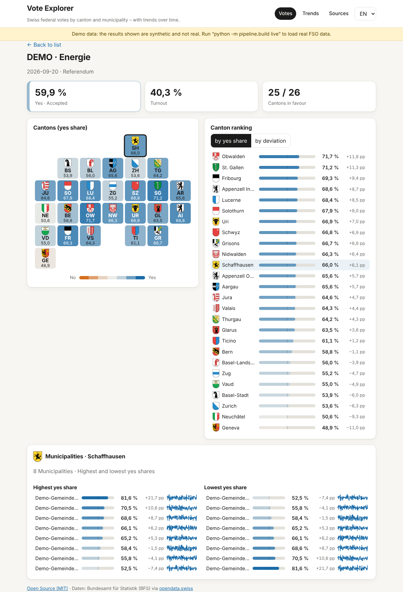

# Abstimmungs-Explorer

Explore Swiss federal votes by **canton** and **municipality**, with **trends over time**.
Static site (no framework, no build step, no runtime dependencies) plus a small stdlib-only Python pipeline
that turns official open data into compact JSON files.

<p align="center">
  <br>
  <sub>Screenshots show <b>synthetic demo data</b>, not real results.</sub>
</p>

## Features

- **Vote list** – every federal proposal, searchable, filter by year, outcome and type
- **Vote detail** – national result, Ständemehr count, **canton tile map** (every canton equally sized), ranking by yes share or deviation from the national result, **municipality** top/bottom lists with sparklines
- **Trends** – compare up to six cantons over time; view yes share or *deviation from the national result* (a Röstigraben / urban–rural lens); optional moving average and keyword filter for topics
- Accessible by default: colour-blind-safe diverging scale (orange ↔ blue), keyboard navigation, dark mode, DE/EN UI
- Fast: municipality data is lazy-loaded per canton

## Quick start

```bash
git clone https://github.com/lars4/abstimmungs-explorer
cd abstimmungs-explorer

python3 -m pipeline.build demo     # synthetic data, no network – good for hacking on the UI
python3 -m pipeline.build live     # real data from BFS / opendata.swiss (needs internet)
python3 -m http.server 8000 --directory web
# open http://localhost:8000
```

Requirements: Python ≥ 3.10 (standard library only). Node ≥ 20 only for the tests/screenshots.

```bash
npm test         # JS unit tests + Python pipeline tests (offline)
npm run smoke    # headless-Chromium smoke test + screenshots (needs `playwright`)
```

## Data sources

| Source | Used for | Notes |
|---|---|---|
| BFS PxWeb `px-x-1703030000_100` | Results by canton since 1866 | opendata.swiss: *Volksabstimmungen – Ergebnisse Ebene Kanton* |
| BFS PxWeb `px-x-1703030000_101` | Results by municipality since 1960 | loaded from `--muni-since` (default 1990) to keep the payload small |
| opendata.swiss *Echtzeitdaten am Abstimmungstag* | Latest vote Sundays not yet in the PxWeb tables | resource URLs are discovered via the CKAN API, nothing hard-coded |
| SRF | **not used** | I found no documented public data API; scraping a media site would be fragile and legally unclear. PRs welcome if SRF publishes one |
| Cantonal / communal portals | **planned** | See [docs/ADDING_A_SOURCE.md](docs/ADDING_A_SOURCE.md) – adapters are ~50 lines each. Cantonal proposals have a separate opendata.swiss real-time dataset |

### Status

The BFS table layouts (variables `Kanton`, `Datum und Vorlage`, `Ergebnis`, and the combined
`Kanton (-) / Bezirk (>>) / Gemeinde (......)` variable) were checked against the live tables with `pipeline.build inspect`,
and the loaders are tested offline with fixtures in that exact layout. The optional gap-fill from the opendata.swiss
real-time dataset is the least-verified part; if it fails, the build prints a warning and continues with the PxWeb data.

If BFS renames a variable, the pipeline stops with a message instead of writing partial data:

```bash
python3 -m pipeline.build inspect                  # print the variables BFS actually exposes
python3 -m pipeline.build live --map vote="Datum und Vorlage" --map measure=Ergebnis
```

The deploy workflow refuses to publish demo data or a suspiciously small dataset.

The BFS API rate-limits clients (HTTP 429). Requests are spaced out (`--delay`, default 1.5 s), the server's
`Retry-After` is honoured, and chunk sizes are halved automatically if the server rejects a request as too large.
A full run takes a few minutes.

## How it works

```
BFS PxWeb ──┐                      ┌── web/data/votes.json            (list + meta)
opendata.swiss ─► pipeline/ ─► Store ├── web/data/cantons.json          {vote: {canton: [yes, turnout]}}
(planned) cantons ┘                 └── web/data/municipalities/ZH.json {names, results}
                                                     │
                                       web/ (vanilla ES modules, SVG charts) ◄── GitHub Pages / any static host
```

- `pipeline/bfs_px.py` – generic json-stat2 client: resolves variable roles by label, chunks requests under the cell limit
- `pipeline/voteinfo.py` – fills the gap to the latest vote Sunday; only adds dates not already present
- `pipeline/store.py` – normalises everything to one compact schema; `votes.json` carries `meta.demo` so demo data can never be mistaken for real data
- `web/js/lib.js` – pure functions (colour scale, filtering, series, tile-grid) – unit tested
- `web/js/charts.js` – dependency-free SVG tile map, line chart, sparkline

Vote IDs are `YYYYMMDD-n` (n = order within the Sunday). Percentages are rounded to 0.1.

## Deploy

**GitHub Pages** – push to `main`; `.github/workflows/pages.yml` fetches live data, sanity-checks it and deploys `web/`.
It re-runs on vote Sundays (afternoon/evening) and Monday morning. Enable *Settings → Pages → Source: GitHub Actions* once.

**Your own server** – `XIRVIK_TARGET=user@host:/var/www/site/abstimmungen ./scripts/deploy.sh` (rsync of `web/`).

**Portfolio card** – [docs/portfolio-card.html](docs/portfolio-card.html) is a self-contained card with live numbers.

## Limitations

- Municipality time series are not harmonised across mergers; names/IDs follow the source.
- Only federal proposals are shown (cantonal/communal: planned).
- Provisional real-time results on vote Sundays can be revised by the BFS afterwards.

## Data & licence

Code: [MIT](LICENSE). Data: © Swiss Federal Statistical Office (BFS), via opendata.swiss – *open use, source must be cited*;
the BFS PxWeb tables are listed as "open-by-ask" and commercial use may need permission. Check the current
[terms of use](https://opendata.swiss/terms-of-use) before reusing the data commercially. This project is not affiliated with the BFS.

## Contributing

Issues and PRs welcome – especially new source adapters. Please keep the pipeline dependency-free and add a fixture-based test.
